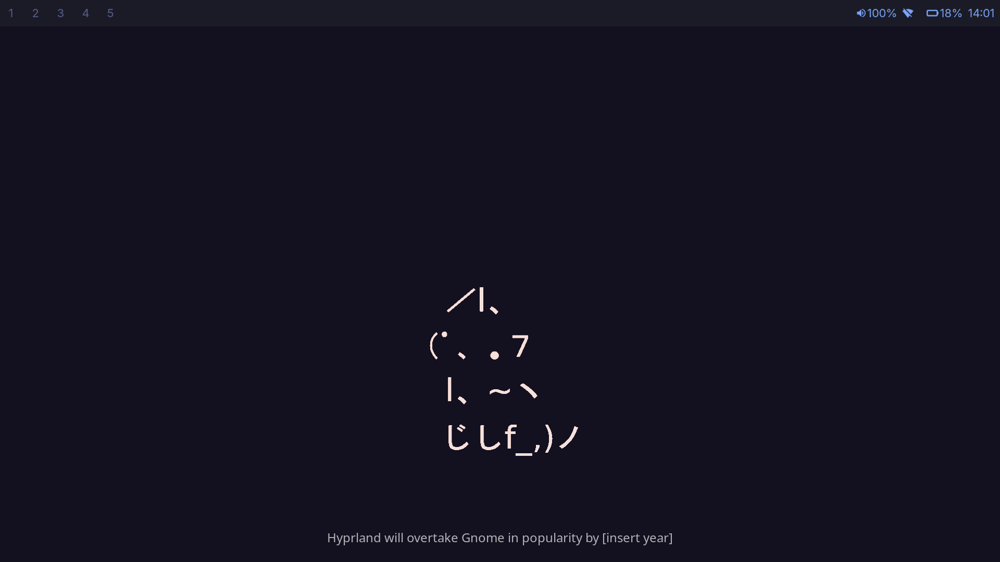

# My Config

Hyprland dotfiles for Arch Linux (Tokyo Night theme), plus an optional
NixOS + Home Manager flake in [`nixos/`](nixos/).



## Included

- **WM**: Hyprland (Lua-based config, keybinds, idle, lock, wallpaper)
- **Wallpaper**: `awww` (fade transitions) + `wofi-wallpaper` picker
- **Colors**: Matugen generates the palette from the wallpaper
- **Bar**: Waybar (workspaces, audio, network, battery, clock)
- **Launcher**: Wofi (+ `wofi-power` menu)
- **Notifications**: Mako
- **Terminals**: Kitty, Alacritty
- **File Manager**: Yazi (terminal-based)
- **Shell**: Zsh (zinit + Powerlevel10k, zoxide, fzf)
- **Editor**: Neovim (LazyVim-based)
- **Browser**: LibreWolf
- **System Info**: Fastfetch
- **Cursor**: Bibata Modern
- **Extra**: Bluetooth (`bluetui`), WiFi (`wifitui`), screenshots
  (`grim` + `slurp` + `wl-clipboard`), Stylus export

> **Note:** every script can be run with `bash <script>` — no need to
> `chmod` unless you prefer `./<script>`.

## Quick Start

### Arch Linux

**From the Arch ISO → `arch-chroot`:**

```bash
pacman -S --noconfirm git
git clone https://github.com/Momokh99/My-config /root/My-config
cd /root/My-config
bash setup.sh packages
```

`makepkg`/`yay` refuse to run as root, so the AUR packages are skipped there.
After the first reboot, install them as your normal user:

```bash
yay -S --needed --noconfirm bibata-cursor-theme wifitui-bin
```

**After reboot (as a normal user):**

```bash
sudo mv /root/My-config ~/My-config
sudo chown -R "$USER":"$USER" ~/My-config
cd ~/My-config
bash setup.sh
```

`setup.sh` with no arguments starts the interactive wizard. It asks, in order:

1. **Shell** — `zsh` (default), `bash`, `fish`, or keep the current one;
   optionally set it as the default shell.
2. **Packages** — package groups (`essentials`, `hyprland`, `terminal`,
   `theme`, `apps`, `aur`), then an optional per-package pass.
3. **Configs** — 19 config entries, all selected by default.
4. **Backup** — optionally snapshot the current configs before linking.
5. **Matugen** — install/link, theme targets, wallpaper, action
   (`theme`, colors-only, none) and regeneration.
6. **Summary** — nothing is changed until you confirm.

### Non-interactive

```bash
bash setup.sh packages --packages=essentials,hyprland    # add aur:foo for extra AUR packages
bash setup.sh shell --shell=zsh --set-default
bash setup.sh config --configs=all --backup
bash setup.sh matugen --matugen-targets=hyprland,kitty,waybar \
                      --wallpaper=repo:wallpaper-26.png \
                      --theme-action=theme
bash setup.sh backup
bash setup.sh all
```

Add `--dry-run` anywhere to print the resolved plan without changing anything.

## `setup.sh` reference

| Subcommand | What it does |
|---|---|
| `packages` | `pacman -Syu`, install the selected pacman packages, then `yay` + AUR packages when run as a normal user |
| `shell` | Install/select a shell and optionally `chsh` to it |
| `config` | Back up and symlink the dotfiles into `~/.config/` and `~/.local/bin/` |
| `backup` | Copy the current configs to `~/config/config<date>/` |
| `matugen` | Save the Matugen target selection and apply a wallpaper/palette |
| `all` | `shell` + `config` + `matugen` |

| Option | Meaning |
|---|---|
| `--shell=zsh\|bash\|fish\|none` | Shell choice for `shell`/`all` |
| `--set-default` / `--no-set-default` | Change the login shell with `chsh` |
| `--packages=all\|none\|group,pkg` | Package groups or individual packages (`aur:pkg` forces AUR) |
| `--configs=all\|none\|name,name` | Config entries to link |
| `--backup` / `--no-backup` | Snapshot before linking (or skip it) |
| `--matugen=yes\|no\|install` | Enable/disable Matugen and its package/config link |
| `--matugen-targets=all\|none\|list` | Which apps Matugen regenerates |
| `--wallpaper=repo:<file>\|path:<file>\|current\|none` | Palette source image |
| `--theme-action=theme\|colors-only\|none` | Set wallpaper + colors, colors only, or nothing |
| `--regenerate` | Re-apply the current wallpaper's palette |
| `--dry-run` | Print what would happen |
| `-y`, `--yes` | Skip the wizard's final confirmation |

Notes:

- Only `packages` may run as root; the other subcommands refuse to run as root
  (they would write into `/root`).
- AUR packages are skipped when running as root, and the command to run later
  is printed.
- On NixOS, `config` warns first and `~/.local/bin` wrappers are left to
  Home Manager.

## Matugen

Matugen generates `colors.css` / `colors.lua` for Hyprland, kitty, Mako,
Waybar, the three wofi menus, GTK 3/4, Qt5/Qt6 and KDE from the current
wallpaper.

- Real targets (12): `hyprland`, `kitty`, `mako`, `waybar`, `wofi`,
  `wofi-power`, `wofi-screenshot`, `gtk3`, `gtk4`, `qt5ct`, `qt6ct`, `kde`.
- `wofi-wallpaper` has no Matugen template in `matugen/config.toml`, so its
  colors are static.
- The selection is stored in
  `~/.local/state/matugen/selected.toml` (outside the repo). `set-theme.sh`
  uses it for later wallpaper changes, including the `wofi-wallpaper` picker
  and the Hyprland autostart.
- Choosing **all** targets deletes the state file and uses the repo config;
  choosing **none** writes a config with no templates.
- Matugen's existing post-hooks reload kitty, Mako, Waybar, GTK and KDE.

## Backups

`setup.sh backup` (or the wizard's backup step) copies the config directories
to `~/config/config<date>/`, preserving relative paths such as
`.config/kdeglobals` and `tmux/.tmux.conf`. Re-running on the same day
replaces that day's copy instead of nesting it.

When `config` replaces an existing physical directory it keeps a `*.bak`
sibling. Restore by copying back from `~/config/config<date>/` or from the
`.bak` directory.

The last wallpaper is remembered in
`~/.cache/current-wallpaper`; `set-theme --restore` re-applies it on login.

## NixOS

The flake lives in [`nixos/`](nixos/) and defines the `x280` host:

```bash
sudo nixos-rebuild switch --flake ~/Projects/My-config/nixos#x280
```

Notes:

- `nixos/home/dotfiles.nix` expects the repo at
  `/home/momo/Projects/My-config` and links the config directories with live
  symlinks (`mkOutOfStoreSymlink`), so Matugen can keep writing into them.
- The scripts need wrappers on NixOS (`#!/usr/bin/env bash` does not exist);
  Home Manager wraps `wofi-power`, `wofi-screenshot`, `wofi-wallpaper`,
  `set-theme` and `gtk-themes-reload`.
- Do not run `setup.sh config` on NixOS — Home Manager owns those links and
  wrappers. The script detects NixOS and warns/refuses.
- `setup.sh shell` points to `users.defaultUserShell` instead of running
  `chsh`.

## Keybinds (SUPER = Windows/Mod4)

| Key | Action |
|---|---|
| SUPER + Return | Terminal (kitty) |
| SUPER + E | File manager (kitty + yazi) |
| SUPER + space | App launcher (wofi) |
| SUPER + B | Browser (librewolf) |
| SUPER + N | Editor (kitty + nvim) |
| SUPER + O | Editor (kitty + opencode) |
| SUPER + C | Open My-config in nvim |
| SUPER + I | WiFi (kitty + wifitui) |
| SUPER + D | Bluetooth (kitty + bluetui) |
| SUPER + L | Power menu (wofi-power) |
| SUPER + W | Kill active window |
| SUPER + SHIFT + Q | Exit Hyprland (hyprshutdown, else hyprctl) |
| SUPER + V | Toggle floating |
| SUPER + F | Fullscreen |
| SUPER + P | Pseudo-tiling |
| SUPER + J | Toggle split |
| SUPER + S | Toggle special workspace (scratchpad) |
| SUPER + SHIFT + S | Move window to scratchpad |
| SUPER + Escape | Toggle Waybar on/off |
| CTRL + ALT + R | Restart Hyprland |
| CTRL + Escape | Toggle gaps / rounding / border 0 ↔ default |
| SUPER + left/right/up/down | Move focus |
| CTRL + Left/Right | Cycle workspaces |
| CTRL + SHIFT + Left/Right | Cycle existing workspaces |
| SUPER + &/é/"/'/(-/_/è/ç/à | Switch to workspace 1-10 (AZERTY) |
| SUPER + SHIFT + &/é/"/'/(-/_/è/ç/à | Move window to workspace 1-10 (AZERTY) |
| Print | Screenshot menu (full / region / clipboard) |
| CTRL + W | Wallpaper picker (wofi-wallpaper) |
| XF86Audio* | Volume / media keys (wpctl / playerctl) |
| XF86MonBrightness* | Brightness keys (brightnessctl) |
| SUPER + mouse:LMB | Drag window |
| SUPER + mouse:RMB | Resize window |

## Screenshots

`Print` opens the `wofi-screenshot` menu:

- Full Screen
- Region
- Clipboard Region
- Clipboard Full Screen

Files are saved to `~/Pictures/screenshoot/` (the directory name is kept as
-is). Clipboard modes use `wl-copy`.

## Theme

Tokyo Night by default: dark background `#1a1b26`, blue accent `#7aa2f7`,
JetBrainsMono Nerd Font and the Bibata Modern cursor. Picking a wallpaper runs
`set-theme`, which fades the wallpaper in with `awww` and regenerates the
palette with Matugen.

## Legacy scripts

`setup.sh` replaces the old entry points, but they are still in the repo:

| Script | Equivalent |
|---|---|
| `install_pack.sh` | `setup.sh packages` |
| `change_Shell.sh` | `setup.sh shell` |
| `install_conf.sh` | `setup.sh config` |
| `backup.sh` | `setup.sh backup` |

## Repository layout

```text
hypr/            Hyprland Lua config, modules, wallpaper/
waybar/          Waybar config and Matugen colors
wofi*/           Launcher + power/screenshot/wallpaper menus
mako/            Notification daemon config and colors
kitty/           Kitty config and Matugen theme
alacritty/       Alacritty config
gtk-3.0/         GTK3 config and Matugen colors
gtk-4.0/         GTK4 config and Matugen colors
qt5ct/ qt6ct/    Qt color schemes
matugen/         Matugen config, templates, GTK reload hook
tmux/            .tmux.conf
nvim/            Neovim (LazyVim) config
yazi/            Yazi config
fastfetch/       Fastfetch config
nixos/           NixOS flake + Home Manager modules
setup.sh         Interactive installer (recommended)
*.sh             Legacy setup helpers, wallpaper/screenshot/power helpers
```